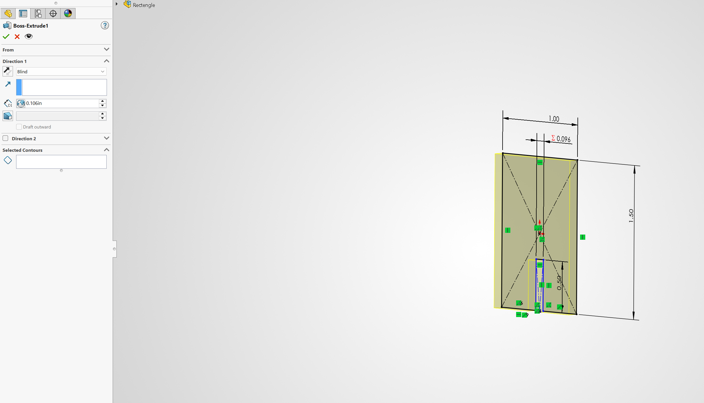
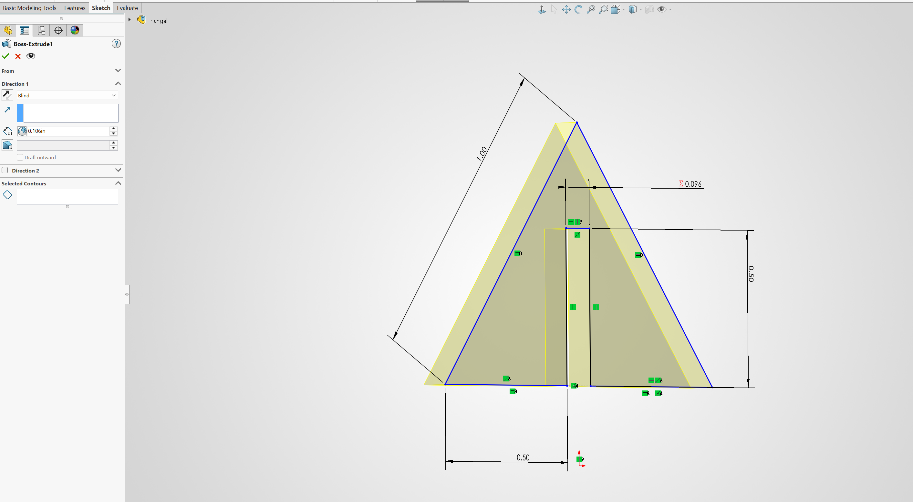
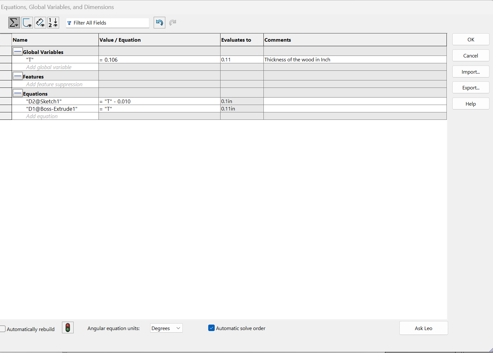

# Lab #9 Laser Cutter: Parametric Construction Kit Portfolio

## Design

### CAD Process & Design Decisions
* **Part Types & Geometry:** The construction kit consists of 3 unique interlocking part profiles: a **Half Circle** (R = 1.00 in), a **Rectangle** (1.00 in x 1.50 in), and a **Triangle** (1.00 in x 1.00 in x 1.10 in).
*  **Hand Sketch**
  

* **Joint Selection & Rationale:** We selected press-fit slot joints to join components perpendicularly without fasteners or glue. Initial test cuts with a 1k tolerance yielded loose fits because the laser beam vaporized material along the vector path. To fix this, we engineered an intentional interference fit by adjusting our slot width parameter to be smaller than the stock material thickness.
* **CAD Modeling Workflow:**
  1. Sketched outer boundary profiles for the Half Circle, Rectangle, and Triangle in SolidWorks.
     
     
     
  2. Added central rectangular slot features symmetrically centered along the base axis.
  3. Linked extrusion depth and slot dimensions directly to global equations.
     
  4. Extruded all sketches to the measured material thickness (T = 0.106 in).

### Parameter Table
| Variable name | Value | Units | Source (measured or chosen) | What it controls |
| :--- | :--- | :--- | :--- | :--- |
| **Material thickness (T)** | 0.106 | in | Measured (Step 1) | Extrusion depth of the wood stock |
| **Kerf** | ~0.007 | in | Measured (Step 2) | Material removed by the laser beam diameter |
| **Clearance / Offset** | 0.010 | in | Chosen (Step 4) | Allowance to tighten slot width and correct loose fits |
| **Slot width** | 0.096 | in | Calculated (0.106 - 0.010) | Width of joint opening ensuring a snug press-fit |

### Parametric Proof & Engineered Allowances
* **Parametric Equations & Proof:** All part files are tied to SolidWorks global variables (Sigma). Modifying the material thickness or clearance variable in the equations table instantly updates both extrusion depth (0.106 in) and slot gap width (0.096 in) across all components simultaneously, proving robust parametric control.
  * Parametric change shown:
 

  
* **Engineered Allowances Traced to Measured Data:**
  * **Measured Thickness:** Caliper measurements across multiple points on the sheet yielded a mean thickness of T = 0.106 in (avoiding nominal 1/8" assumptions).
  * **Kerf Measurement Calculations:** Average Kerf roughly equals 0.007 in. Final Kerf allowance for 10k Tolerance was set to 0.009 to 0.010 in.
    
    
  * **Final Slot Sizing:** To counteract laser kerf expansion and loose fits, the final target slot width was set to 0.096 in (0.010 in tighter than the 0.106 in wood thickness).

---

## Manufacturing, including Process Research

### Process Research
Laser cutting is a non-contact thermal manufacturing process where high-density optics focus a CO2 laser beam to melt and vaporize material along vector cut lines. Pressurized air assist clears molten debris and suppresses flare-ups along the kerf.

* **Comparison with FDM 3D Printing:**
  * **Speed:** Laser cutting processes 2D sheet profiles in seconds or minutes, whereas FDM printing takes hours to deposit 3D volumes layer-by-layer.
  * **Geometric Limits:** FDM handles complex 3D internal cavities and overhangs, while laser cutting is restricted to 2.5D planar sheet extrusions of uniform thickness.

### Process of Cutting the Parts
1. **Design the parts:** Modeled parametric 3D parts using global variables in SolidWorks.
2. **2D Sheet Setup:** Drew the 2D layout on a clear custom size 12 in x 12 in sheet at a 1:1 scale ratio.
3. **Save Drawing:** Exported and saved the 2D drawing vector paths as a .dxf file.
4. **Import to Inkscape:** Imported the .dxf file into Inkscape (ensured all dimensions were changed to Inch English units since the Epilog laser machine operates in inch units).
5. **Set Vector Styling:** Applied No fill and only used stroke paint lines in Inkscape. Since we were strictly cutting vector profiles, no color fill was required.
6. **Send to Printer:** Used Ctrl + P to print and selected Epilog as the active printer.
7. **Configure Epilog Settings:** In the Epilog print driver properties, selected Vector cutting mode (since we were cutting through stock), material type, and material thickness.
   
8. **Adjust Machine Parameters for Full Cut:** Epilog automatically adjusts its operating parameters based on the selected material type. The default factory settings for plywood were Speed 20%, Power 100%, and Frequency 20%. During initial cutting passes, the laser did not cut entirely through the sheet at some locations. To resolve this, we decreased the cutting speed to 15%, which successfully allowed the laser beam to cut cleanly all the way through the material.

### Laser Process Record
| Setting | Kerf coupon | Fit coupon | Final cut |
| :--- | :--- | :--- | :--- |
| **Laser cutter (name or number)** | Epilog Laser Cutter | Epilog Laser Cutter | Epilog Laser Cutter |
| **Material type** | Plywood / MDF | Plywood / MDF | Plywood / MDF |
| **Nominal thickness** | 0.125 in (1/8") | 0.125 in (1/8") | 0.125 in (1/8") |
| **Measured thickness (mean)** | 0.106 in | 0.106 in | 0.106 in |
| **Speed** | 20% (Default) | 15% (Adjusted) | 15% (Adjusted) |
| **Power** | 100% | 100% | 100% |
| **Frequency or PPI** | 20% | 20% | 20% |
| **Number of passes** | 1 | 1 | 1 |
| **Focus method and how you confirmed it** | Manual focus tool gauge | Manual focus tool gauge | Manual focus tool gauge |
| **Air assist on? Exhaust on?** | Both ON | Both ON | Both ON |
| **How you set origin and alignment** | Top-left corner (12x12 sheet) | Top-left corner (12x12 sheet) | Top-left corner (12x12 sheet) |

### Test Coupons, Nesting, Video & Edge Quality
* **Test Coupons & Fit Evaluation:** Initial cuts expanded internal slot openings up to 0.1170 in, creating loose, wobbly joints. Reducing CAD slot width to 0.096 in (Sigma 0.096) secured a snug press-fit.
* **Test parts**
   
  
* **Layout & Nesting:** Parts were nested tightly inside the 12 in x 12 in Inkscape sheet with shared vector lines to reduce laser head travel path and prevent thermal warping.
* **Video Capture:** A continuous video clip recording the Epilog vector cut execution was captured.
* **Edge Quality & Cleanup:** Air assist suppressed flare-ups. Decreasing speed from 20% to 15% produced clean, fully penetrated cuts. Minor soot along cut edges was cleaned using fine-grit sandpaper and wiped with isopropyl alcohol.

### Final Part and Process Video

<video controls width="100%">
  <source src="Laser%20cutting%20process%20Video.mp4" type="video/mp4">
  Your browser does not support the video tag.
</video>

### File Downloads & Project Resources
* **SVG Cut Sheet (10k Tolerance):** [Download 10 Parts Tolerance 10k.svg](10%20Parts%20Tolerance%2010k.svg)
* **SolidWorks Part Files & Drawings:**
  * [Download Half Circle Part File (.SLDPRT)](half%20Circle.SLDPRT)
  * [Download Half Circle Drawing File (.SLDDRW)](half%20Circle.SLDDRW)
  * [Download Rectangle Part File (.SLDPRT)](Rectengle.SLDPRT)
  * [Download Triangle Part File (.SLDPRT)](Triangel.SLDPRT)

---

## Lessons Learned

### Process Log & Total Time

| Date and time | Time spent | Step | What happened | Decision or change made |
| :--- | :--- | :--- | :--- | :--- |
| Oct 22, 2026 | 4.0 hrs | Steps 1-4 | Evaluated test fit failures due to laser kerf expansion. | Applied 0.010 in tighter clearance offset; updated CAD slot width to 0.096 in. |
| Oct 27, 2026 | 4.0 hrs | Step 6 | Initial writing of the assignment. | Waiting for final cut. |
| Oct 28, 2026 | 2.0 hrs | Step 5 & 6 | Exported DXF to Inkscape (12x12 in sheet), set vector cuts, decreased speed from 20% to 15% to achieve complete cut-through, and assembled kit. | Verified firm press-fits; compiled portfolio documentation and log. |

**Total Time Spent:** 10.0 hours from start to finish.

### Mistakes, Troubleshooting & Resources
* **Mistakes & Fixes:**
  * **Loose Joint Fits:** Assuming nominal 1/8" (0.125 in) stock thickness caused oversized, loose slots. Resolved by using caliper-measured thickness (0.106 in) and adjusting CAD parameters (Sigma 0.096 in slot width).
  * **Incomplete Vector Cuts:** Default Epilog speed (20%) left uncut sections on the plywood sheet. Fixed by reducing vector cutting speed to 15% for full kerf penetration.
* **Resources Used:**
  * 1/8-inch Plywood stock sheet (12 in x 12 in).
  * SolidWorks 2026 CAD & Inkscape software.
  * Digital vernier calipers.
  * Fine-grit sandpaper and isopropyl cleaning wipes.
  * Workflow tutorials: [SolidWorks drawings to laser cutting](https://www.youtube.com/watch?v=RAEBoMR3T-I) and [SolidWorks model to Inkscape to laser cutting](https://www.youtube.com/watch?v=ptxyHT09A2M).
  * **Acknowledgments:** Special thanks to the Lab Associate who assisted us in setting up the Epilog laser machine and configuring computer hardware connectivity.

### Reflection Prompts
1. **Where did your measured values differ from what you assumed (nominal thickness, expected kerf)? What would have happened if you had used the assumed value?**
   * *Answer:* Nominal thickness was assumed to be 0.125 in, but measured stock mean thickness was 0.106 in. Laser kerf enlarged slot widths by up to 0.012 in. Using nominal values without kerf compensation would cause severe joint play and structural collapse.
2. **Using Taguchi's quality loss function, describe one joint in your kit that works but is not on target. What would that loss mean if the part were made by the thousands?**
   * *Answer:* A slot joint cut slightly wider than ideal still holds mechanically, but strays from the nominal target. According to Taguchi's quality loss function (Loss = k * (y - target)^2), small dimensional deviations lead to progressive quality degradation—causing wobble and accelerated wear. At mass production scales, this leads to elevated defect rates and customer returns.
3. **Name a real product that uses cut sheet parts joined by tabs and slots... How would a kerf or thickness error show up for the customer?**
   * *Answer:* Flat-pack wooden furniture or desktop organizers use tab-and-slot joinery. Uncompensated kerf causes wobbly assemblies requiring adhesive, while uncompensated material thickness prevents tabs from sliding into slots without fracturing the material.
4. **If you had one more cut, what would you change, and why?**
   * *Answer:* Since our initial test with a 0.001 in clearance resulted in loose-fitting joints due to laser kerf widening the slots to 0.1170 in, we successfully corrected the design by applying a 0.010 in offset (0.096 in CAD slot width). If we had one more cut, we would perform a fine-tuning adjustment of plus or minus 0.001 to 0.002 in around our new 0.096 in baseline (testing 0.095 in vs. 0.097 in). This would pinpoint the exact golden mean between insertion force and structural rigidity, allowing smooth hand assembly without risking edge chipping or micro-play.
